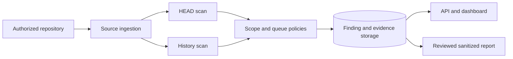

# Code Exposure Scanner

  [](LICENSE)

A defensive code-exposure pipeline for authorized repository review: discover sources, scan current files and history, retain findings with evidence, and prepare sanitized reports for review.

The important distinction is between **a detection candidate**, **its source evidence** and **a disclosure decision**. They have separate modules and should not be treated as one automatic action.

## Pipeline and persistence



[scan_policy.py](secret_hunter/scan_policy.py) restricts the distributed scanner's retained categories and excludes dependency/vendor paths. Its wallet categories and catalogued AI-provider credentials are narrower than an unrestricted generic secret search. [queue_policy.py](secret_hunter/queue_policy.py) controls work selection; [evidence.py](secret_hunter/evidence.py) and storage modules retain the finding context.

Redis Streams, PostgreSQL and SQLite serve different execution/storage paths. Configuration determines which path is active; installing the package does not provision the distributed service.

## Local setup before any collection

```console
python -m venv .venv
python -m pip install -r requirements.txt
python -m compileall -q secret_hunter
```

Review [.env.example](.env.example), the [CLI](secret_hunter/cli.py) and [API](secret_hunter/api.py) before starting discovery. Keep authorization scope explicit and reports redacted. Credential validation adapters and notification/disclosure code exist in the source; a candidate must not be tested or disclosed merely because a detector matched it.

## Where the engineering lives

- [head_scan.py](secret_hunter/head_scan.py) and [history_scan.py](secret_hunter/history_scan.py): different source surfaces.
- [event_bus.py](secret_hunter/event_bus.py): distributed event boundary.
- [disclosure.py](secret_hunter/disclosure.py): separate reporting workflow.
- [tests](tests): policy, recovery, detection and integration cases. Some require external services; source compilation is not a substitute for those tests.

This repository provides analysis tooling, not proof that a matched credential is active, that every secret format is detectable, or that a disclosure has been authorized.

**Technology:** Python · PostgreSQL · Redis Streams · SQLite paths · HTTP API · Docker

Project-authored source: [MIT](LICENSE). Third-party components retain their own notices and terms.
