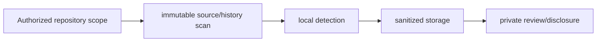

# Code Exposure Scanner

**Scoped code inspection, sanitized findings and recoverable defensive workflows.**

  [](LICENSE)

[Overview](#overview) · [Quickstart](#quickstart) · [Example](#example) · [Validation](#validation) · [Documentation](#documentation)

## Overview

A defensive pipeline for authorized code-secret discovery, sanitized findings and responsible disclosure workflows.

**Stack:** Python · PostgreSQL · Redis Streams · SQLite paths · HTTP API · Docker

## Separate detection from disclosure

| Component | Behavior |
| --- | --- |
| Scope | Repository discovery and immutable blob retrieval identify the exact input being inspected. |
| Detect | Pattern and structural detectors produce findings for review. |
| Recover | Queue/state components track work separately from optional notification paths. |

## Processing path



## Quickstart

```console
python -m venv .venv
# Activate .venv, then:
python -m pip install -e .
python -m compileall -q secret_hunter
```

The commands above install prerequisites or run the specified offline checks. Live collection, cloud operations, messaging and trading are separate operational steps when present.

## Example

**Inspect the workflow**

Follow one authorized repository through source retrieval, detection and sanitized finding storage. Review candidate confidence and false-positive context before disclosure. The documented quickstart installs and checks Python syntax; it does not initiate repository discovery or validate a credential.

## Configuration and storage

[config.example.yaml](config.example.yaml) and [.env.example](.env.example) define scope, quotas and secret-file paths. PostgreSQL tracks jobs/findings; Redis Streams transports events. Raw-evidence modes can carry sensitive material and need separate retention/access controls.

## Repository guide

| Location | Responsibility |
| --- | --- |
| [secret_hunter/cli.py](secret_hunter/cli.py) | CLI orchestration |
| [secret_hunter/config.py](secret_hunter/config.py) | Configuration |
| [secret_hunter/ai_detection/scanner.py](secret_hunter/ai_detection/scanner.py) | Detection boundary |
| [secret_hunter/schema.sql](secret_hunter/schema.sql) | Persistence schema |

## Validation

The quickstart lists the declared checks. No passing CI or coverage claim is implied by the technology badges.

## Scope and operational boundaries

Candidate detection is not proof of a live credential. Live discovery, validation and notification are separate operations. Example fixtures contain invalid markers; never substitute a real secret in a shared fixture.

## Documentation

- The repository guide above links directly to the implementation and configuration files.

## License and attribution

Project-authored source code is licensed under the [MIT License](LICENSE). Third-party components and datasets retain their respective rights and licenses.
