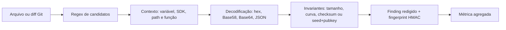

# Metodologia cripto para o TCC

## Objetivo

Medir, de forma passiva e reproduzível, a prevalência de material criptográfico
sensível publicado em repositórios públicos recém-criados. A primeira fase cobre
EVM e Solana; outros provedores entram somente depois de estabilizar o corpus,
os detectores e as métricas desta fase.

O projeto detecta exposição. Ele não usa a chave, não consulta saldo, não assina,
não transmite transações e não tenta descriptografar wallets.

## Pergunta de pesquisa

> Em uma amostra temporal definida de repositórios públicos recém-criados, qual
> proporção contém material privado EVM ou Solana estruturalmente plausível no
> conteúdo atual ou no histórico Git?

"Publicado pelo próprio usuário" não pode ser provado apenas pelo Git: nome e
e-mail de autor de commit são campos declarativos e podem ser forjados. O dado
observável correto é "material presente em commit do repositório". Associação ao
proprietário exige uma regra separada e deve ser relatada como inferência.

## Por que não existe um regex para cada rede EVM

Ethereum, Base, BNB Smart Chain, Robinhood Chain, Polygon, Arbitrum, Optimism,
Avalanche C-Chain e outras redes EVM reutilizam uma chave privada secp256k1 de
32 bytes. A mesma chave pode controlar o mesmo endereço em várias dessas redes.
A rede é um atributo de contexto — RPC, chain ID, nome de variável ou arquivo —
não do formato da chave.

O detector EVM, portanto, procura um escalar hexadecimal de 64 caracteres apenas
quando existe contexto forte de chave privada, wallet, signer, deployer, relayer
ou construtores conhecidos. Em seguida descarta zero, valores fora da ordem da
curva e candidatos de baixa plausibilidade. Hashes e endereços sem contexto não
são classificados como chave.

## Formatos cobertos

| Tipo | Encoding | Regra estrutural |
|---|---|---|
| `evm_private_key` | hex de 32 bytes, com ou sem `0x` | contexto forte + `0 < k < n(secp256k1)` |
| `evm_keystore_v3` | JSON v3 criptografado | `version`, `crypto`, `cipher`, `ciphertext`, `kdf`, `mac`; nunca descriptografa |
| `solana_keypair_json` | array de 64 bytes | contexto Solana/path sensível + seed/pubkey consistentes quando PyNaCl está disponível |
| `solana_keypair_base58` | Base58 de 64 bytes | decodificação + contexto de segredo/keypair |
| `solana_keypair_base64` | Base64/Base64URL de 64 bytes | decodificação + contexto Solana |
| `solana_keypair_hex` | hex de 64 bytes | decodificação + contexto Solana |
| `solana_seed_array` | array de 32 bytes | contexto explícito `fromSeed`/seed |
| `solana_seed_base58` | Base58 de 32 bytes | contexto explícito de seed; evita confundir pubkey |
| `solana_seed_base64` | Base64/Base64URL de 32 bytes | contexto explícito de seed |
| `solana_seed_hex` | hex de 32 bytes | contexto explícito de seed Solana |
| `bip39_mnemonic` | 12, 15, 18, 21 ou 24 palavras | contexto + wordlist inglesa + checksum BIP39 |

Keystore EVM v3 é artefato sensível, mas não equivale a uma private key em texto
puro. Ele possui tipo e risco separados para não inflar artificialmente a métrica
principal.

## Pipeline de classificação

Regex isolado não é evidência final. Ele serve para limitar o espaço de busca; a
classificação depende dos demais estágios.

## Casos negativos obrigatórios

O corpus de regressão deve conter, no mínimo:

- endereço EVM de 20 bytes;
- transaction hash de 32 bytes;
- bytecode e salt CREATE2;
- assinatura ECDSA/Ed25519;
- public key Solana Base58;
- arrays numéricos comuns sem contexto de keypair;
- frases naturais de 12 a 24 palavras;
- mnemonic com palavra ou checksum inválido;
- keystore EVM criptografado separado de chave em texto puro;
- placeholders e fixtures explicitamente marcadas.
- exemplos e documentação dentro de dependências vendorizadas (`node_modules`, ambientes Python, `.pnpm`, `.yarn`);
- checksums de dependência em `Cargo.lock`.

## Métricas acadêmicas

Para uma janela de observação congelada:

- `N`: repositórios elegíveis escaneados com sucesso;
- `R`: repositórios com pelo menos um finding cripto estrutural;
- prevalência observada: `R / N`;
- distribuição por tipo, encoding, linguagem, arquivo e localização atual/histórica;
- intervalo de confiança de 95% para proporção, preferencialmente Wilson;
- precisão, recall e F1 em corpus rotulado separado;
- taxa de resultados inconclusivos e falhas de scan, sem removê-las silenciosamente.

A prevalência observada não deve ser chamada de probabilidade universal. A
amostra é afetada por indexação do GitHub, repositórios removidos, limites de API,
filtros de tamanho, histórico inacessível e detectores ainda desconhecidos.

## Unidade e deduplicação

A unidade principal recomendada é repositório, não ocorrência. A mesma chave em
vários commits conta uma vez na prevalência por repositório, mas suas localizações
podem ser analisadas separadamente. O fingerprint HMAC permite deduplicar sem
persistir o segredo bruto.

## Política ética e de dados

1. Somente repositórios públicos dentro da janela declarada.
2. Nenhuma consulta de saldo, RPC, explorer, autenticação, assinatura ou broadcast.
3. Nenhum segredo bruto no PostgreSQL, log, dashboard, relatório ou dataset do TCC.
   As respostas HTTP brutas ficam em Redis isolado, protegido por senha única e
   fora do dataset acadêmico exportado.
4. Resultados acadêmicos apenas agregados; exemplos usam fixtures sintéticas.
5. Divulgação externa permanece separada e exige revisão humana.
6. Uma detecção `not_checked` significa apenas detecção passiva.

## Fontes técnicas primárias

- Ethereum Accounts: https://ethereum.org/developers/docs/accounts
- Ethereum Yellow Paper: https://ethereum.org/content/developers/tutorials/yellow-paper-evm/yellow-paper-berlin.pdf
- Solana Keypair API: https://solana-foundation.github.io/solana-web3.js/v1.x/classes/Keypair.html
- Solana program deployment/keypair files: https://solana.com/docs/programs/deploying
- BIP-0039: https://github.com/bitcoin/bips/blob/master/bip-0039.mediawiki
- Base wallet compatibility: https://docs.base.org/base-chain/quickstart/connecting-to-base
- BNB Smart Chain EVM compatibility: https://docs.bnbchain.org/bnb-smart-chain/developers/json_rpc/json-rpc-endpoint/
- Robinhood Chain EVM compatibility: https://docs.robinhood.com/chain/

## Próxima etapa científica

O primeiro corpus sintético rotulado e seu gate reproduzível estão descritos em
[TCC_CRYPTO_BENCHMARK.md](TCC_CRYPTO_BENCHMARK.md). O baseline perfeito nesse
corpus conhecido não prova acurácia externa.

Antes da coleta principal, criar uma avaliação cega separada, congelar o pattern
set e registrar o protocolo de amostragem. Só depois executar uma janela piloto
pequena e revisar manualmente falsos positivos. O scan global não é o primeiro
experimento.